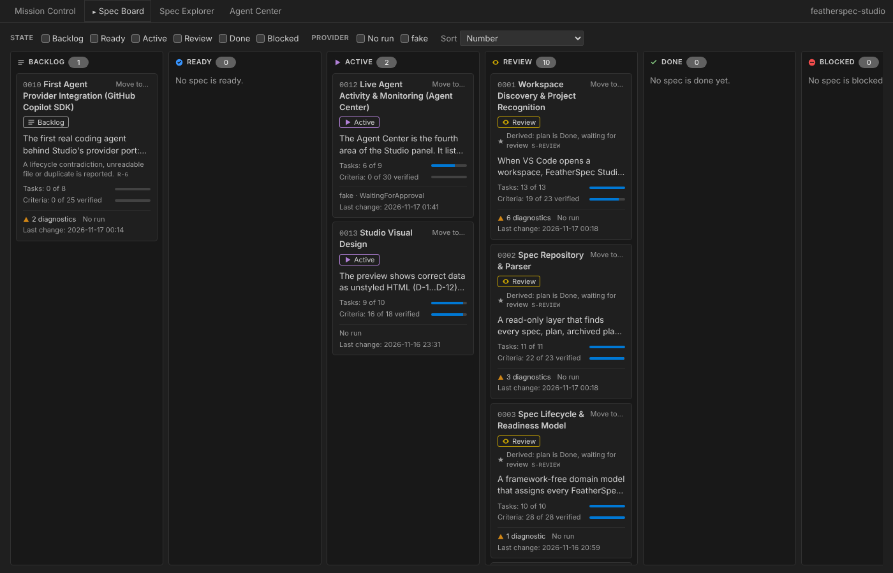
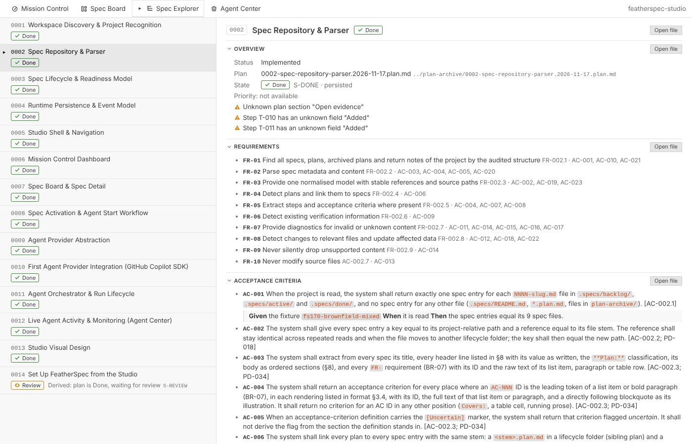

# FeatherSpec Studio

A VS Code panel for projects that use [FeatherSpec](https://github.com/GregorBiswanger/featherspec), the lightweight spec-driven development template for AI coding agents. Studio reads your specs, plans and Memory Bank, shows where every spec stands, and names each spec's next FeatherSpec step, ready to paste into the AI assistant you work with — GitHub Copilot, Claude Code or any other.

Studio reads your project and starts no agent; the work with your agent stays in your assistant's chat. The one exception to read-only is [Set up FeatherSpec](#set-up-featherspec), which you start and confirm yourself.

## Feature tour

Open Studio from the **FeatherSpec Studio** icon in the Activity Bar or with `FeatherSpec Studio: Open`. The panel has three areas.

### Mission Control

A dashboard of the active project: one header line (folder, FeatherSpec version, time of the last project update, problems), six tiles with the number of specs per board state, a distribution bar, a progress figure with its rule in words (done specs with status Implemented or Baseline ÷ all specs without Deprecated), the specs that need attention with their reasons (blocked, problem, review pending) and the ten latest activities. Every count and row opens the matching place in the Spec Board or Spec Explorer. A *Needs attention* row also shows the spec's next step ("Next", the short form) with its own **Copy** button, which copies without opening anything. A figure the sources cannot deliver reads "not available".

### Spec Board

Every spec as a card in six columns: Backlog, Ready, Active, Review, Done and Blocked. A card shows number, title, state (a derived state reads as a sentence; hover it for the rule behind it), description, task and criteria progress, problems and the last change; a Backlog card shows what the spec still needs. Filter by state or a named set of specs; sort by number, title or last change. The last line of a card is the next step: **Next** and the short form of the command (for example `/sdd-plan`) with a **Copy** button that puts the full line on your clipboard. The board works with the keyboard: arrow keys move between cards, Enter opens a card, Tab from the card reaches its **Copy**, Enter or Space copies. The board moves no spec; lifecycle moves belong to FeatherSpec's `/sdd-lifecycle`.

### Spec Explorer

The spec list beside the detail of the selected spec. Above its sections the detail shows **Next step**: the FeatherSpec command that moves this spec on, for example `/sdd-plan .specs/backlog/0007-example.md`. **Copy** puts that line on your clipboard; paste it into your assistant's chat. A second line ("Then: …") names the step after it. The sections are overview, requirements, acceptance criteria, plan and tasks, verification, related artifacts and status history. Every section folds from its heading and offers "Open file", which opens the spec, plan or return note in the editor. The selection survives switching areas, closing the panel and reloading the window.

### The next step everywhere

The next step is one line of FeatherSpec, shown in four places and copied with one click: in the Spec Explorer detail, on every Spec Board card, on each *Needs attention* row in Mission Control and in the status bar. Studio starts no agent and changes no file; paste the line into your assistant's chat. On an Active spec with an open plan step the detail adds a second line, `continue`, for the same chat ("Then, in the same chat, if nothing blocks:").

The status bar shows the spec you work on: `<number> · <state> · <short form>`. The current spec is the one selected in the Spec Explorer or Spec Board; without a selection, the most urgent spec with a step (Blocked, then Review, then Active). A click copies the full line and the entry reads **Copied** for two seconds. Without a current spec the click opens a quick pick of the specs that have a step. The tooltip carries the project name and the FeatherSpec version, an "Open Studio" link and, with several projects, "Switch project".

## Requirements

- VS Code 1.146 or newer (desktop).
- A workspace folder that is a FeatherSpec project: an `AGENTS.md` with a `FeatherSpecVersion:` line and a `.specs/` directory at the folder root. Older projects without the version line count when they have a `.claude/commands/sdd-*.md` file.
- An AI assistant that runs FeatherSpec commands, to act on the next step Studio names. Studio itself needs no account and no network.

## Getting started

1. Install the extension and open a FeatherSpec project folder. The status bar shows the active project and its FeatherSpec version.
2. Click the FeatherSpec Studio icon in the Activity Bar, then "Open Studio".
3. Read the **Next** line on a card, a *Needs attention* row or in the status bar (or the **Next step** of a spec in the Spec Explorer), click **Copy** and paste the line into your assistant's chat.

## Set up FeatherSpec

In a workspace folder without a FeatherSpec project, the Studio view in the Activity Bar offers **Set up FeatherSpec** (also `FeatherSpec Studio: Set Up FeatherSpec` in the Command Palette). It needs a trusted workspace.

1. Studio downloads the latest FeatherSpec release from GitHub (`github.com`, no account, no token).
2. It shows what it would do in the folder and asks you to confirm. Nothing is written before that.
3. It creates the files that are missing, completes `.gitignore` and `.vscode/settings.json` with the lines FeatherSpec needs, and never overwrites a file of yours. A file that differs from the release is kept as it is; its release version is parked in `.featherspec-setup/`.
4. If files were parked, the folder stays "setup not finished". **Copy merge prompt** puts a prompt on your clipboard that tells your coding agent how to merge them; the folder becomes a project once `.featherspec-setup/` is gone.

Links inside the folder are written through, so a file behind a link changes where the link points. No file of yours is deleted, renamed or moved; a later run replaces the content of `.featherspec-setup/` with that run's parked copies. The root `AGENTS.md` is created last, so an interrupted setup leaves the folder incomplete rather than half a project. Walkthrough: [Hands-On](https://github.com/GregorBiswanger/featherspec/wiki/Hands-On-Walkthrough).

## How board states are derived

Studio derives each spec's column from the files, in this order:

- in `.specs/done/` → **Done**;
- the plan or a return note says Blocked → **Blocked** (derived);
- in `.specs/active/` with spec status In Progress and plan status Done → **Review** (derived);
- in `.specs/active/` → **Active**;
- in `.specs/backlog/` and passing the readiness checks (a draft with a plan that has not started) → **Ready** (derived);
- otherwise → **Backlog**.

A spec with contradictory or unreadable files stays in the column of its folder and shows the reason. Derived states read as a sentence on the card; the rule ID (`S-READY`, `S-REVIEW`, `S-BLOCKED`) is in its tooltip. FeatherSpec has no priority, persisted compile verdict or dependency field, so the Studio shows none.

## Commands

| Command | What it does |
| --- | --- |
| `FeatherSpec Studio: Set Up FeatherSpec` | Download the latest FeatherSpec release and set it up in a folder without a project, after a confirmation |
| `FeatherSpec Studio: Open` | Open the panel on the area last shown |
| `FeatherSpec Studio: Open Mission Control` / `Open Spec Board` / `Open Spec Explorer` | Open the panel on that area |
| `FeatherSpec Studio: Copy Next Step` | Copy the next step of the current spec (same as a click on the status bar entry); without a current spec, pick a spec from a list |
| `FeatherSpec Studio: Rescan Project` | Read the specs of the active project again |
| `FeatherSpec Studio: Select Project` | Choose the active project when the workspace has several |
| `FeatherSpec Studio: Refresh Project Discovery` | Run project discovery again |

## Privacy and stored data

- Studio has no telemetry. It reads your workspace and writes only its own status history. The one exception is [Set up FeatherSpec](#set-up-featherspec): after you start it, it downloads the latest release from `github.com` and `codeload.github.com` (no account, no token, only a `User-Agent` header) and, once you confirm, writes the release files into the folder you chose. Nothing else contacts a network service on its own.
- Studio starts no process and no agent. The next step is a text line; it reaches your assistant only when you paste it.
- The status history (the changes of a spec's state that Studio observed while it was running) is stored on your machine in VS Code's global storage of the extension, outside your workspace, per project. Entries older than 90 days are removed when Studio starts. Earlier builds of Studio also stored agent run data; Studio removes it at the next start. Details, location and how to delete it by hand: [docs/runtime-data.md](docs/runtime-data.md).

## Known limitations

- Studio names the next step; it does not run it. Lifecycle moves between folders belong to FeatherSpec's commands in your assistant.
- Only the VS Code window that holds the project's write lock records the status history; a second window shows it read-only. The next step and **Copy** work in every window.
- Projects are detected at workspace folder roots only, not in subfolders.
- Restricted Mode: Studio shows the project and the next step; Set up FeatherSpec needs a trusted workspace.
- Virtual workspaces (such as vscode.dev) are not supported. Remote, WSL and Dev Container workspaces have not been tried.

## Learn more

- FeatherSpec: <https://github.com/GregorBiswanger/featherspec>
- What Studio stores: [docs/runtime-data.md](docs/runtime-data.md)
- Issues: <https://github.com/GregorBiswanger/featherspec-studio/issues>

## Development

`npm run test:unit` (unit tests), `npm run compile` (type check, lint, bundle), `npm test` (extension-host tests; they download VS Code). Specs and plans live in `.specs/`, project context in `.memory-bank/`, the constitution in `AGENTS.md`.

## License

[MIT](LICENSE)
