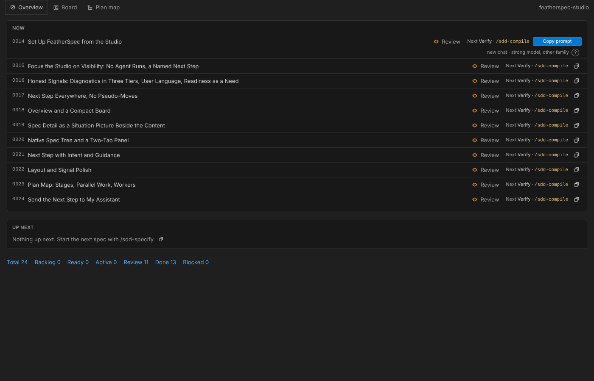
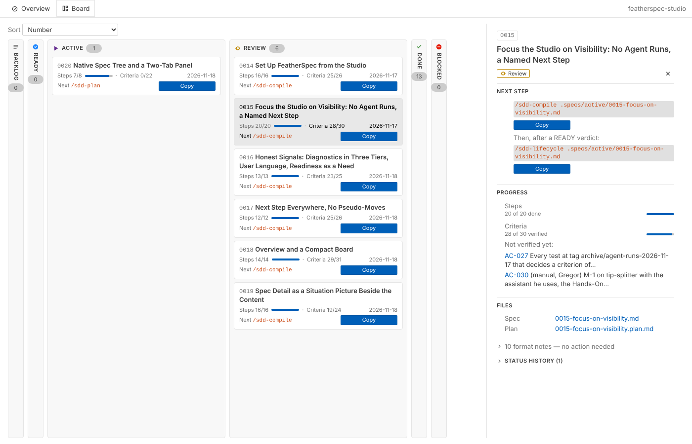

# FeatherSpec Studio

A VS Code panel for projects that use [FeatherSpec](https://github.com/GregorBiswanger/featherspec), the lightweight spec-driven development template for AI coding agents. Studio reads your specs, plans and Memory Bank, shows where every spec stands, and names each spec's next FeatherSpec step, ready to paste into the AI assistant you work with — GitHub Copilot, Claude Code or any other.

Studio reads your project and starts no agent; the work with your agent stays in your assistant's chat. The one exception to read-only is [Set up FeatherSpec](#set-up-featherspec), which you start and confirm yourself.

## Feature tour

The **FeatherSpec Studio** icon in the Activity Bar opens the **Specs** view: every spec as a row in four groups, with the next step on a click away. The panel (the toolbar's **Open** button, or `FeatherSpec Studio: Open`) has three tabs, Overview, Board and Plan map.

### The Specs view

The groups are **In progress** (Blocked, Review, then Active), **Ready**, **Backlog** and **Done** (collapsed until you open it); each shows its count, and a group without a spec is left out. A group that holds a spec with a problem adds the number of problems to its count and shows a warning icon, open or collapsed. A row reads `<number> <title>`, with the short form of the next step beside it (for example `/sdd-compile`; a spec without a step shows its state), an icon and a colour that carry the state; label and description together stay within 32 characters, and the step is never cut. Hover a row for the title, the reason behind a derived state, the next step, the progress (steps and criteria) and any problem; a screen reader hears the same as one sentence. A click selects the spec and shows its detail in the panel (the panel opens if it is closed, without taking focus). A row with a next step has an inline **Copy Next Step** button; the context menu offers **Open Spec**, **Open Plan** and **Copy Next Step**. The badge on the Activity Bar icon counts the specs that wait for you (Review and Blocked). The toolbar has **Open** and **Refresh**; the view follows every change of your files within half a second. `FeatherSpec Studio: Focus on Specs View` reaches the view from the keyboard; Shift+F10 on a row opens its context menu. With several projects in the workspace the view's description names the active one.

### Overview

What is in progress, what comes next and what needs fixing, one line per spec: **Now** lists the specs in Blocked, Review and Active, **Up next** (Ready first, then Backlog) the next three ("+ n more" opens the rest on the Board), **Problems** every spec or project file with a problem, in a sentence (hover for the technical reason). A row shows number, title, the state as an icon (its name in the tooltip) and the spec's next step ("Next" and the step short form, for example `Verify · /sdd-compile`) with its own **Copy prompt**, which copies without opening anything. A row follows the width of its own list: one line when wide, two when narrower, three when narrow. Only the first Now row and the Copy prompt of an empty project are primary buttons; every other Copy in a list or on a card is a small icon button that turns into a check once copied. A click, Enter or Space on a row selects the spec and shows its detail in a side panel next to the Overview; the area does not change. One line of figures shows the total and the number of specs per board state; hover it for the progress (done specs with status Implemented or Baseline ÷ all specs without Deprecated). **Activity** is collapsed until you open it and lists the ten latest status changes. Hover the project name in the panel header for the FeatherSpec version and the time of the last update. A figure the sources cannot deliver reads "not available".

### Board

Every spec as a card in six columns: Backlog, Ready, Active, Review, Done and Blocked. A column without a card is a narrow strip with its name and count; the other columns share the width, and the board scrolls sideways when they do not fit. **Done** is collapsed until you open it with its toggle, and Studio remembers your choice per workspace. A card has three rows: number and title; what matters in its state (a Backlog card shows what the spec still needs, a Blocked card why, otherwise the steps and criteria progress), a warning with the number of problems and the day of the last change; and the next step. Hover a Ready, Review or Blocked column header for the rule behind the state, and a card for its description. The day comes from the plan's `Last updated:` line, else from the file's modification time; it is left out while all specs show the same day. Opening the Board from the Overview with a filter shows one **Filter: …** chip with **Clear filters**; sort by number, title or last change. The last line of a card is the next step: **Next**, the short intent and the short form of the prompt (for example `Plan · /sdd-plan`) with a **Copy prompt** button that puts the full line on your clipboard. The board works with the keyboard: arrow keys move between cards, Enter or Space selects a card and shows its detail in the side panel, Tab from the card reaches its **Copy prompt**, Enter or Space copies. The board moves no spec; lifecycle moves belong to FeatherSpec's `/sdd-lifecycle`.

### Plan map

The third tab shows one spec's plan as stages. Select a spec that has a plan (in the tab's own list, the Specs view, the Overview or the Board) and each stage is a row: `Stage 2 — add and subtract`, with a line that says whether its steps run in order or can run in parallel because they share no file. Steps are cards with their files and the acceptance criteria they cover, side by side where they can run together; open a card for what to do and how it is verified. A finished stage folds to the step IDs. The side panel stands beside the map from 900 px; below that the map shows alone.

For the stage you are on, **Ways to run stage 2** offers three prompts to copy: in sequence (one chat builds the steps one after another), with subagents, or with other agents (one start line per step for a second chat, tool or worktree; commit first). A worker leaves a return note; once steps have returned, the next step is **Integrate the returned steps** and the map shows `Returned · done` or `Returned · blocked` on the cards. The Plan section in the detail gives the same picture in short, with a link to the map. Studio only shows and copies: it starts no agent and writes no file.

### The detail of a spec

Select a spec in the Specs view, on the Board or in the Overview (click, Enter or Space) and its detail opens in a **side panel** to the right of the area; the area stays where it is. Set the width with the **divider** between the area and the panel (move it with the pointer, or focus it and press the arrow keys; Enter or a double click resets it); Studio remembers it for the workspace. Below 900 px the area or the detail shows alone: a back button at the top of the detail returns to the area, and so does Escape. Beside the area, close the panel with its close button or Escape; focus returns to the card or row you came from. The selection survives switching tabs, closing the panel and reloading the window. The panel is a picture of the spec's situation, not a copy of its files: the state, **Next step** (with **Copy prompt**), the **Problems**, **Progress** (steps done and the next open step; criteria verified and the ones still open), the **Files** (spec, plan, archived plans, return notes) and, folded, the **Format notes** and the **Status history**. Every ID and file name is a link: it opens the file in the editor **beside** the Studio, at the line where the ID is defined. A file that is gone reads "File not found: ..." at the link.

### The next step everywhere

The next step is a prompt for your assistant, shown in five places and copied with one click: on a row of the Specs view (its inline **Copy Next Step**), in the detail of a spec, on every Board card, on each row of Now, Up next and Problems in the Overview and in the status bar. Every line says what it does before you copy it: in the detail each prompt sits under its intent (for example "Have the result verified" over `/sdd-compile`, "Continue with T-003 Reject money values" over `Implement T-003 of <plan>`); cards, rows and the quick pick show a short intent beside the short form of the prompt (`Verify · /sdd-compile`), the tree keeps the short form of the prompt, and every tooltip shows the intents with the full prompts. **Copy prompt** puts exactly the prompt on the clipboard, never the intent. Studio starts no agent and changes no file; paste the prompt into your assistant's chat. On an Active spec with an open plan step the detail offers two prompts: `Implement <ID> of <plan>` builds exactly that step and stops, and `/sdd-plan <spec>` under "Not sure where it stands? Let the agent report first" has the agent report where the plan stands; without an open step the one prompt lets the agent report where the plan stands. In the detail, the first prompt's **Copy prompt** is the primary button and further prompts have a secondary one.

Under the first prompt of the detail, and in the first Now row of the Overview, a **coach line** says where to run it and with which kind of model, for example `new chat · strong model, other family`. The **?** button beside it, named **About this step**, opens four short paragraphs: what the step does and what comes next, why that chat and that model, and what stays yours. Escape, a second click or a click elsewhere closes it; Escape closes only it, not the panel. Switch both off with the setting `featherspec-studio.showStepTips` (see [Settings](#settings)).

The status bar shows the spec you work on: `<number> · <state> · <short form>`. The current spec is the one selected in the Specs view, the Overview or the Board; without a selection, the most urgent spec with a step (Blocked, then Review, then Active). A click copies the full line and the entry reads **Copied** for two seconds. Without a current spec the click opens a quick pick of the specs that have a step. The tooltip carries the project name and the FeatherSpec version, an "Open Studio" link and, with several projects, "Switch project".

### Send to your assistant

Choose your assistant once with the setting `featherspec-studio.assistant` (**Open Settings**, the gear in the Specs view, takes you there): `none` (the default), `copilot` or `claudeCode`. While that assistant's extension is installed and enabled, the first prompt of the detail and the first Now row of the Overview offer **Send to Copilot** or **Send to Claude Code** in place of **Copy prompt**. The button opens the assistant's chat with the prompt already in its input; it sends nothing, you read the prompt and send it yourself. The arrow beside the button opens a menu with the other chat (GitHub Copilot can open a new chat or use the current one; Claude Code opens a new chat) and **Copy prompt**. The default is a new chat where the step wants a fresh session (the verification and the review) and the current chat otherwise. If the chat cannot be opened, Studio copies the prompt and says so in one notification. Without the setting, or without the extension, nothing changes: you see **Copy prompt** only, and Codex and other assistants keep working the same way.

## Requirements

- VS Code 1.146 or newer (desktop).
- A workspace folder that is a FeatherSpec project: an `AGENTS.md` with a `FeatherSpecVersion:` line and a `.specs/` directory at the folder root. Older projects without the version line count when they have a `.claude/commands/sdd-*.md` file.
- An AI assistant that runs FeatherSpec commands, to act on the next step Studio names. Studio itself needs no account and no network.

## Getting started

1. Install the extension and open a FeatherSpec project folder. The status bar shows the spec you work on (`<number> · <state> · <short form>`); the tooltip names the project and its FeatherSpec version.
2. Click the FeatherSpec Studio icon in the Activity Bar. The Specs view lists your specs; select one, or use **Open** in its toolbar for the panel.
3. Read the **Next** line on a card, an Overview row or in the status bar (or the **Next step** in the detail of a spec), read what it does under its intent, click **Copy prompt** and paste the prompt into your assistant's chat.

## Set up FeatherSpec

In a workspace folder without a FeatherSpec project, the Specs view in the Activity Bar offers **Set up FeatherSpec** (also `FeatherSpec Studio: Set Up FeatherSpec` in the Command Palette). It needs a trusted workspace.

1. Studio downloads the latest FeatherSpec release from GitHub (`github.com`, no account, no token).
2. It shows what it would do in the folder and asks you to confirm. Nothing is written before that.
3. It creates the files that are missing, completes `.gitignore` and `.vscode/settings.json` with the lines FeatherSpec needs, and never overwrites a file of yours. A file that differs from the release is kept as it is; its release version is parked in `.featherspec-setup/`.
4. If files were parked, the folder stays "setup not finished". **Copy merge prompt** puts a prompt on your clipboard that tells your coding agent how to merge them; the folder becomes a project once `.featherspec-setup/` is gone.

Links inside the folder are written through, so a file behind a link changes where the link points. No file of yours is deleted, renamed or moved; a later run replaces the content of `.featherspec-setup/` with that run's parked copies. The root `AGENTS.md` is created last, so an interrupted setup leaves the folder incomplete rather than half a project. Walkthrough: [Hands-On](https://github.com/GregorBiswanger/featherspec/wiki/Hands-On-Walkthrough).

## How board states are derived

Studio derives each spec's column from the files, in this order:

- in `.specs/done/` → **Done**;
- the plan or a return note says Blocked → **Blocked** (derived);
- in `.specs/active/` with spec status In Progress and plan status Done → **Review** (derived);
- in `.specs/active/` → **Active**;
- in `.specs/backlog/` and passing the readiness checks (a draft with a plan that has not started) → **Ready** (derived);
- otherwise → **Backlog**.

A spec with contradictory or unreadable files stays in the column of its folder and shows a sentence that says what is wrong (the technical reason is in its tooltip). Hover a Ready, Review or Blocked column header on the Board for the rule behind a derived state; the rule ID (`S-READY`, `S-REVIEW`, `S-BLOCKED`) is in its tooltip. FeatherSpec has no priority, persisted compile verdict or dependency field, so the Studio shows none.

## Commands

| Command | What it does |
| --- | --- |
| `FeatherSpec Studio: Set Up FeatherSpec` | Download the latest FeatherSpec release and set it up in a folder without a project, after a confirmation |
| `FeatherSpec Studio: Open` | Open the panel on the area last shown |
| `FeatherSpec Studio: Open Overview` / `Open Board` / `Open Plan Map` | Open the panel on that tab |
| `FeatherSpec Studio: Focus on Specs View` | Move the keyboard focus into the Specs view |
| `FeatherSpec Studio: Copy Next Step` | Copy the prompt of the next step of the current spec (same as a click on the status bar entry); without a current spec, pick a spec from a list |
| `FeatherSpec Studio: Open Settings` | Open the Settings UI at the settings of this extension (the gear in the Specs view) |
| `FeatherSpec Studio: Select Project` | Choose the active project when the workspace has several |
| `FeatherSpec Studio: Refresh` | Run project discovery again, then read the specs of the active project again |

## Settings

The settings are under **FeatherSpec Studio** in the Settings UI and apply at once, in every window. The choice of the assistant is read from your user settings and, in a trusted workspace, from the workspace; in Restricted Mode only your user value counts.

| Setting | Default | What it does |
| --- | --- | --- |
| `featherspec-studio.showStepTips` | `true` | Show the coach line and the **About this step** button. With `false`, intents, prompts and **Copy prompt** stay as they are. |
| `featherspec-studio.modelHints` | `{}` | The names of your own models, `strong` and `fast`, for the coach line, for example `{ "strong": "my best model", "fast": "my quick model" }`. Plain text, at most 40 characters; Studio ships no model name and never switches a model. |
| `featherspec-studio.assistant` | `none` | The AI assistant that **Send to Copilot** or **Send to Claude Code** opens: `none`, `copilot` (GitHub Copilot Chat, `GitHub.copilot-chat`) or `claudeCode` (Claude Code, `anthropic.claude-code`). Studio only fills the chat input and sends nothing; any other value acts as `none`. |

## Privacy and stored data

- Studio has no telemetry. It reads your workspace and writes only its own status history. The one exception is [Set up FeatherSpec](#set-up-featherspec): after you start it, it downloads the latest release from `github.com` and `codeload.github.com` (no account, no token, only a `User-Agent` header) and, once you confirm, writes the release files into the folder you chose. Nothing else contacts a network service on its own.
- Studio starts no process and no agent. The next step is a text line; it reaches your assistant only when you paste it, or when you choose Send to Copilot or Send to Claude Code, which fill the chat input and send nothing.
- The status history (the changes of a spec's state that Studio observed while it was running) is stored on your machine in VS Code's global storage of the extension, outside your workspace, per project. Entries older than 90 days are removed when Studio starts. Earlier builds of Studio also stored agent run data; Studio removes it at the next start. Details, location and how to delete it by hand: [docs/runtime-data.md](docs/runtime-data.md).

## Known limitations

- Studio names the next step; it does not run it. **Send to Copilot** and **Send to Claude Code** fill the chat input and send nothing. Lifecycle moves between folders belong to FeatherSpec's commands in your assistant.
- Only the VS Code window that holds the project's write lock records the status history; a second window shows it read-only. The next step and **Copy prompt** work in every window.
- Projects are detected at workspace folder roots only, not in subfolders.
- Restricted Mode: Studio shows the project and the next step; Set up FeatherSpec needs a trusted workspace.
- Virtual workspaces (such as vscode.dev) are not supported. Remote, WSL and Dev Container workspaces have not been tried.

## Learn more

- FeatherSpec: <https://github.com/GregorBiswanger/featherspec>
- What Studio stores: [docs/runtime-data.md](docs/runtime-data.md)
- Issues: <https://github.com/GregorBiswanger/featherspec-studio/issues>

## Development

`npm run test:unit` (unit tests), `npm run compile` (type check, lint, bundle), `npm test` (extension-host tests; they download VS Code). Specs and plans live in `.specs/`, project context in `.memory-bank/`, the constitution in `AGENTS.md`.

## License

[MIT](LICENSE)
