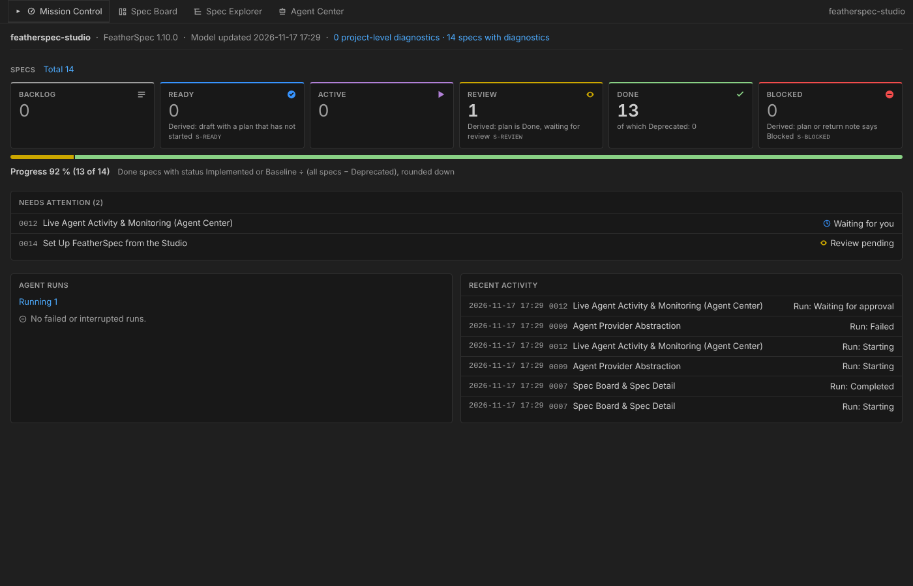
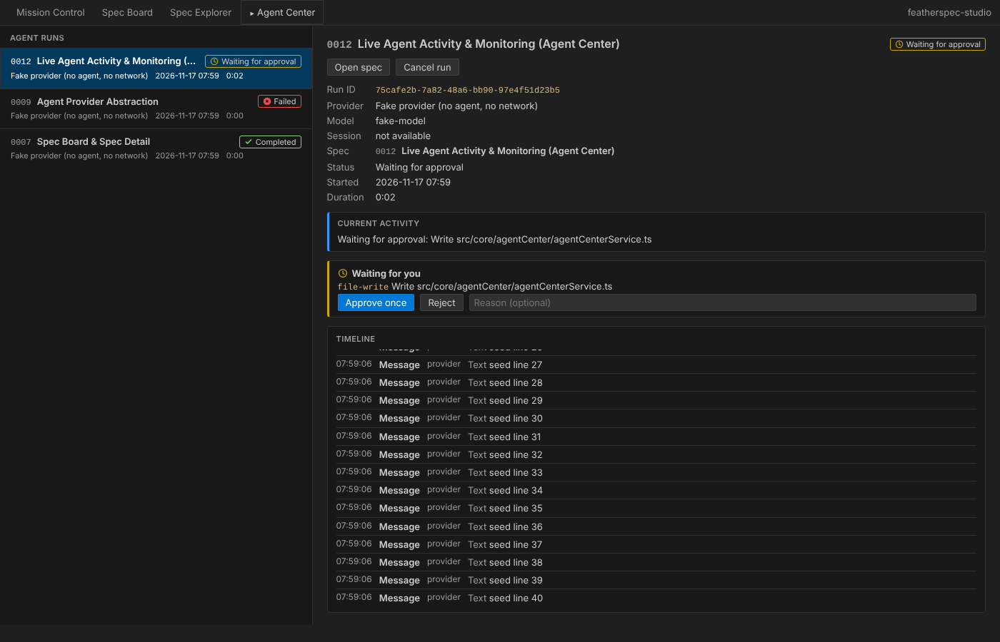

# FeatherSpec Studio

A VS Code panel for projects that use [FeatherSpec](https://github.com/GregorBiswanger/featherspec), the lightweight spec-driven development template for AI coding agents. Studio reads your specs, plans and Memory Bank, shows where every spec stands, and lets you start a coding agent on a spec and follow its run live.

Studio reads your project; it never changes a spec, plan or Memory Bank file. The agent you start changes files, Studio does not. The one exception is [Set up FeatherSpec](#set-up-featherspec), which you start and confirm yourself.

## Feature tour

Open Studio from the **FeatherSpec Studio** icon in the Activity Bar or with `FeatherSpec Studio: Open`. The panel has four areas.

### Mission Control

A dashboard of the active project: one header line (folder, FeatherSpec version, time of the last project update, diagnostics), six tiles with the number of specs per board state, a distribution bar, a progress figure with its rule in words (done specs with status Implemented or Baseline ÷ all specs without Deprecated), the specs that need attention with their reasons (blocked, failed or interrupted run, waiting for you, diagnostic, review pending), the agent runs and the ten latest activities. Every count and row opens the matching place in the Spec Board, Spec Explorer or Agent Center. A figure the sources cannot deliver reads "not available".

### Spec Board

Every spec as a card in six columns: Backlog, Ready, Active, Review, Done and Blocked. A card shows number, title, state (with the rule behind a derived state), description, task and criteria progress, diagnostics, the latest agent run and the last change. Filter by state, provider or a named set of specs; sort by number, title or last change. The board works with the keyboard: arrow keys move between cards, Enter opens a card, and "Move to…" (also Shift+F10) moves it.

### Spec Explorer

The spec list beside the detail of the selected spec: overview, requirements, acceptance criteria, plan and tasks, verification, related artifacts and agent history. Every section folds from its heading and offers "Open file", which opens the spec, plan or return note in the editor. The selection survives switching areas, closing the panel and reloading the window.

### Agent Center

The agent runs of the project, newest first, and the selected run in detail: provider, model, session, status, duration, current activity, the requests that wait for you, the error or result, the files the run changed and a live timeline of its events. Answer an approval with "Approve once" or "Reject", answer a question in the text field, cancel a run, or resume an ended run when the provider supports it. When a run asks for you while it is not in view, a notification offers to open it.

### Starting an agent: drag Ready → Active

Moving a Ready spec to Active on the Spec Board (drag, "Move to…" or `FeatherSpec: Move Spec to…`) starts the agent workflow. Studio checks eight preconditions (for example: the spec is Ready, the FeatherSpec commands the agent needs exist, the provider is available, no other run of the project is open, the workspace is trusted) and lists every one that fails. If all hold, one confirmation shows spec, provider, model, permission mode, what the provider sends where, and the start prompt. Only **Start** begins the run. The prompt tells the agent to read `AGENTS.md`, do the backlog → active move with `/sdd-lifecycle`, implement the whole plan and stop before `/sdd-compile`.

Every other move is refused with the reason: lifecycle moves belong to FeatherSpec's `/sdd-lifecycle`, and Done needs `/sdd-compile` evidence.

## Requirements

- VS Code 1.146 or newer (desktop).
- A workspace folder that is a FeatherSpec project: an `AGENTS.md` with a `FeatherSpecVersion:` line and a `.specs/` directory at the folder root. Older projects without the version line count when they have a `.claude/commands/sdd-*.md` file.
- For real agent runs: the [GitHub Copilot CLI](https://docs.github.com/copilot/how-tos/copilot-cli) 1.0.87 or newer, installed and signed in (run `copilot` once in a terminal, then `/login`), and a Copilot plan. Each prompt counts against that plan.

## Getting started

1. Install the extension and open a FeatherSpec project folder. The status bar shows the active project and its FeatherSpec version.
2. Click the FeatherSpec Studio icon in the Activity Bar, then "Open Studio".
3. To try a run without Copilot, an account or a network: set `featherspec-studio.fakeProvider.enabled` to `true` and `featherspec-studio.defaultProvider` to `fake`, then drag a Ready spec to Active. The fake provider never changes a file.
4. For a real run, install and sign in to the Copilot CLI, keep `featherspec-studio.defaultProvider` at `copilot`, and drag a Ready spec to Active.

## Set up FeatherSpec

In a workspace folder without a FeatherSpec project, the Studio view in the Activity Bar offers **Set up FeatherSpec** (also `FeatherSpec Studio: Set Up FeatherSpec` in the Command Palette). It needs a trusted workspace.

1. Studio downloads the latest FeatherSpec release from GitHub (`github.com`, no account, no token).
2. It shows what it would do in the folder and asks you to confirm. Nothing is written before that.
3. It creates the files that are missing, completes `.gitignore` and `.vscode/settings.json` with the lines FeatherSpec needs, and never overwrites a file of yours. A file that differs from the release is kept as it is; its release version is parked in `.featherspec-setup/`.
4. If files were parked, the folder stays "setup not finished". **Copy merge prompt** puts a prompt on your clipboard that tells your coding agent how to merge them; the folder becomes a project once `.featherspec-setup/` is gone.

Links inside the folder are written through, so a file behind a link changes where the link points. Files are never deleted. The root `AGENTS.md` is created last, so an interrupted setup leaves the folder incomplete rather than half a project. Walkthrough: [Hands-On](https://github.com/GregorBiswanger/featherspec/wiki/Hands-On-Walkthrough).

## How board states are derived

Studio derives each spec's column from the files, in this order:

- in `.specs/done/` → **Done**;
- the plan or a return note says Blocked → **Blocked** (derived);
- in `.specs/active/` with spec status In Progress and plan status Done → **Review** (derived);
- in `.specs/active/` → **Active**;
- in `.specs/backlog/` and passing the readiness checks (a draft with a plan that has not started) → **Ready** (derived);
- otherwise → **Backlog**.

A spec with contradictory or unreadable files stays in the column of its folder and shows the reason. Derived states carry their rule ID (`S-READY`, `S-REVIEW`, `S-BLOCKED`) on the card.

## Commands

| Command | What it does |
| --- | --- |
| `FeatherSpec Studio: Set Up FeatherSpec` | Download the latest FeatherSpec release and set it up in a folder without a project, after a confirmation |
| `FeatherSpec Studio: Open` | Open the panel on the area last shown |
| `FeatherSpec Studio: Open Mission Control` / `Open Spec Board` / `Open Spec Explorer` / `Open Agent Center` | Open the panel on that area |
| `FeatherSpec: Move Spec to…` | Pick a spec and a target column (Ready → Active starts the agent workflow) |
| `FeatherSpec Studio: Rescan Project` | Read the specs of the active project again |
| `FeatherSpec Studio: Select Project` | Choose the active project when the workspace has several |
| `FeatherSpec Studio: Refresh Project Discovery` | Run project discovery again |
| `FeatherSpec Studio: Clear Run History` | After a confirmation, remove ended runs, their events and the spec status history of the active project |
| `FeatherSpec Studio: Stop Run` | After a confirmation, cancel the open run of the active project |
| `FeatherSpec Studio: Resume Run` | After a confirmation, continue an `Interrupted` run as a new run |

## Settings

| Setting | Default | Meaning |
| --- | --- | --- |
| `featherspec-studio.defaultProvider` | `copilot` | Provider that starts an agent when you move a Ready spec to Active; `fake` after enabling the fake provider |
| `featherspec-studio.copilot.cliPath` | empty | Full path of the Copilot CLI (`copilot.exe` on Windows); empty uses the first `copilot` on `PATH`. User settings only |
| `featherspec-studio.copilot.model` | empty | Model for the next Copilot run; empty uses Copilot's default |
| `featherspec-studio.fakeProvider.enabled` | `false` | Register the fake provider (no agent, account or network) |
| `featherspec-studio.fakeProvider.scenario` | `happy-path` | What the fake provider does: approvals, a question, failures per category, a long run, unusual event streams |
| `featherspec-studio.runHistory.maxAgeDays` | `90` | Days Studio keeps ended runs, their events and the spec status history |

## Privacy and stored data

- Studio has no telemetry. It reads your workspace and writes only its own run history. The one exception is [Set up FeatherSpec](#set-up-featherspec): after your confirmation it downloads the latest release from `github.com` and `codeload.github.com` (no account, no token, only a `User-Agent` header) and writes the release files into the folder you chose. Nothing else contacts a network service on its own.
- The run history (runs, their events, the spec status history) is stored on your machine in VS Code's global storage of the extension, outside your workspace, per project. Secrets Studio recognises are replaced by `[masked]` before writing (best effort). Ended runs older than the age cap are removed when Studio starts. Details, location and how to delete it: [docs/runtime-data.md](docs/runtime-data.md).
- A GitHub Copilot run sends the prompt, the files the agent reads, command output and your answers to GitHub. Studio removes `COPILOT_GITHUB_TOKEN`, `GH_TOKEN` and `GITHUB_TOKEN` from the CLI's environment, so only your signed-in account is used, and turns the CLI's telemetry off. Copilot's session files live in Studio's global storage (`copilot-home`).

## Known limitations

- Only one provider ships for real runs: GitHub Copilot. There is no provider picker; the setting decides.
- One open run per project at a time. Only the VS Code window that holds the project's write lock can start, stop, resume or answer; a second window shows the history read-only.
- Studio never moves specs between lifecycle folders except through the agent it starts; use FeatherSpec's commands for that.
- Projects are detected at workspace folder roots only, not in subfolders.
- Restricted Mode: Studio shows the project but offers no agent actions.
- Virtual workspaces (such as vscode.dev) are not supported. Remote, WSL and Dev Container workspaces have not been tried; the Copilot provider does not support remote or virtual workspaces.
- Secret masking in the run history is best effort.

## Learn more

- FeatherSpec: <https://github.com/GregorBiswanger/featherspec>
- Agent provider port and the fake provider: [docs/agent-provider-port.md](docs/agent-provider-port.md)
- Issues: <https://github.com/GregorBiswanger/featherspec-studio/issues>

## Development

`npm run test:unit` (unit tests), `npm run compile` (type check, lint, bundle), `npm test` (extension-host tests; they download VS Code). Specs and plans live in `.specs/`, project context in `.memory-bank/`, the constitution in `AGENTS.md`.

## License

[MIT](LICENSE)
